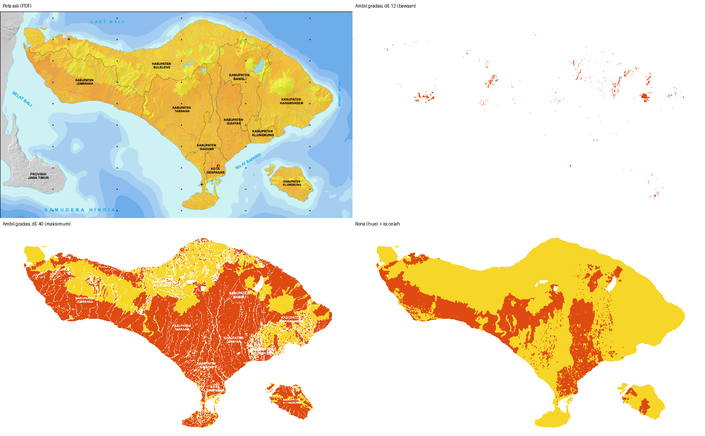
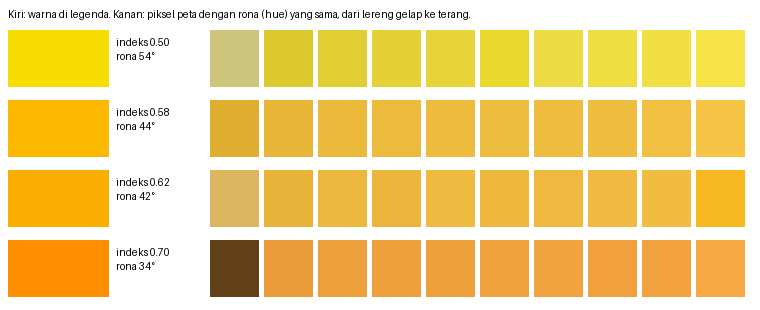

# Inspection: BNPB drought risk map of Bali (PDF → GeoJSON)

**Map:** *10. Peta Risiko Kekeringan Provinsi Bali* (BNPB, Dec 2022), A1, 1 : 200 000, made in CorelDRAW 2018.
**Symptom:** the PDF extractor (`ekstrak-pdf.html`) put the result in the right place, but *Warna legenda → poligon* returned one feature made of scattered specks instead of the risk zones that cover all of Bali.

The PDF is not stored here (GeoSAI does not keep visitors' PDFs). Pass its path to the scripts below.

## Summary

The georeferencing is right. This map uses the same BNPB template as the volcano map ([`../peta-risiko-letusan-bali`](../peta-risiko-letusan-bali)): same frame, same UTM 50 S grid, RMSE 1.7 m over 50 crosses.

The colour step is what fails. It cannot work on this map, whatever colours or tolerance the visitor picks:

* The risk index is painted **at about 71 % opacity over a grey hillshade**. Every land pixel is `0.71 × legend colour + 0.29 × grey`, and the grey runs from about 157 (shaded slopes) to 239 (lit slopes). The fit is exact: the largest channel error is 1.3/255.
* The extractor matches a pixel to a picked colour by **colour distance (CIE ΔE)**. That fails here for two reasons:
  * The opacity moves every map colour **13–20 ΔE away from its legend colour**. At the default tolerance (ΔE 12), only 13 % of the land matches any legend colour, mostly in thin bands that the *ignore lines thinner than 0.8 mm* clean-up then erases. What survives is the specks in your screenshot (1 % of the land).
  * The hillshade spreads one risk value over about **8.5 ΔE** (lit vs. shaded slope), as much as the step from index 0,58 to 0,62 (7.8 ΔE). At the highest tolerance (ΔE 40), almost everything matches, but each pixel goes to whichever legend sample is nearest, and near the 0,6 break that depends on brightness. The bright volcano highlands become *Sedang* and the darker lowlands *Tinggi*. Moving the sampled legend points by 1 pt flips Tinggi from 10 % to 59 % of the land.
* **Hue** (*rona*) is the one property the blend does not change. Mixing a colour with grey, or darkening it, changes its lightness and saturation but not its hue. The hue of a map pixel is the hue of its legend colour, and the legend's hue falls steadily from green (120°) to red (0°). Classifying by hue gives a clean result: **Sedang 74 %, Tinggi 26 %, Rendah ≈ 0 %** of the land (`hasil/D_rona_hue.geojson`).



*Yellow: Sedang. Red: Tinggi. White: unclassified.*

## First principles

1. A colour on a printed map has three parts: lightness, saturation and hue. A risk map normally encodes its index in the colour alone. Here the index is in **hue**. Lightness carries the terrain (hillshade), and saturation is lowered by the 71 % opacity.
2. The legend bar is drawn without hillshade or transparency (saturation 1.0). On the map the same colours have saturation ≈ 0.74 and a lightness set by the slope. So a legend colour never appears on the map unchanged.

   

3. ΔE is the straight-line distance in Lab, where L is lightness. The opacity puts the map 13–20 ΔE from the legend, beyond the default tolerance. The terrain spreads one risk value over about 8.5 ΔE, as much as the colour change between index 0,58 and 0,62. So no tolerance separates the classes near 0,6: the noise (terrain) is as large as the signal (risk).
4. Hue removes the terrain exactly, because grey has no hue. The class breaks are the hues where the legend bar is split: 0,3 ↔ 78° and 0,6 ↔ 41°.

## What the extractor sees in this PDF

From `node diagnose.mjs <pdf>`:

```
frame (pt) [ 58.2, 297.2, 2342.6, 1638.4 ] · picture 200 dpi
fit  crosses 50 · RMSE 1.7 m
map area 6346 × 3725 px
land pixels 8255501 (34.9% of the map area)

[A_satu_warna_legenda]   land matched 0.0% before clean-up · covered 0.0%
[B_gradasi_legenda_dE12] land matched 13.0% before clean-up · covered 1.0%    Tinggi 1.0%
[C_gradasi_legenda_dE40] land matched 98.7% before clean-up · covered 89.3%   Sedang 30.0%, Tinggi 59.3%

class breaks on the legend (hue °, fitted from the left / right of each gap): Rendah|Sedang 77.6 / 79.0, Sedang|Tinggi 40.2 / 41.8
[D_rona_hue]             covered 100.0%   Sedang 74.3%, Tinggi 25.7%
```

| Run | How the colours were picked | Result |
|---|---|---|
| A | One class, one colour clicked in the *Tinggi* part of the legend, ΔE 12 | Nothing |
| B | *Ambil gradasi* over each third of the legend bar (the documented workflow), ΔE 12 | 1 % of the land, in specks (like the screenshot) |
| C | As B, ΔE 40 (slider maximum) | Classes follow the hillshade, not the risk |
| D | Hue, with class breaks read off the legend, then gaps filled | Whole island, zones match the map |

Runs A–C call the extractor's own functions (`colorTable → classify → removeThin → sieve → polygonize` in `public/assets/js/pdfgeo.js`) with the page's default clean-up. The only difference from the page is the renderer: poppler instead of pdf.js. Both draw the same 200-dpi picture.

## How run D works

1. Hue and saturation of each pixel. Pixels with saturation under 0.35 (black, white, grey Java) or hue outside the ramp (blue sea) are left out.
2. Class by hue: > 78.3° Rendah, 41.0°–78.3° Sedang, < 41.0° Tinggi. Each break is the hue at the centre of a white gap in the legend bar. It comes from straight lines fitted to the bar on each side of the gap, because single legend pixels wander ±2° from compression.
3. The page's clean-up (lines < 0.8 mm, areas < 1 mm²). Then the cartography painted on top is filled from the nearest class. That covers rivers, roads, boundaries, labels and grid crosses, up to 1.4 mm wide on paper. The red arterial road would otherwise read as *Tinggi*.
4. Traced into polygons with `PG.polygonize`, the same as the extractor.

`hasil/D_rona_hue.geojson`: two MultiPolygons, `kelas` = Sedang / Tinggi, `nilai` = 2 / 3. They cover 114.43–115.74 E, 8.05–8.86 S. The lakes stay as holes.

### How sure the Sedang/Tinggi line is

Most of Bali sits close to index 0,6: the median is 0,58, and 20 % of the land lies within ±0,02 of the break. The legend fixes the break hue only to about ±0.8°, and that alone moves Tinggi between 23 % and 31 % of the land:

| Break (hue) | 40.0° | 40.2° | **41.0°** | 41.8° | 42.0° |
|---|---|---|---|---|---|
| Tinggi, % of land | 23.2 | 23.9 | **25.7** | 31.2 | 33.3 |

The pattern is solid: Tinggi is south Jembrana, the Tabanan–Badung lowlands, Bangli–Gianyar and west Nusa Penida. Exact areas near the line are not. For official figures, ask BNPB for the source data, the risk index raster behind InaRISK. Don't use areas from this PDF.

## How to get this map out today

* **Use `hasil/D_rona_hue.geojson`.** The extractor's *Warna legenda → poligon* cannot separate classes on a map shaded by a hillshade, whatever tolerance is set.
* The extractor is still right for the vectors (labels, grid) and for the GeoTIFF of the map image (*Gambar peta*). A GeoTIFF can be classified by hue in QGIS. Convert to HSV (or use the raster calculator on R, G, B) and threshold hue at 78° and 41°.

## Files

| File | What |
|---|---|
| `diagnose.mjs` | Georeferences the map with `pdfgeo.js`, renders the map area with poppler at 200 dpi, then runs A–D and the break sensitivity. Writes the GeoJSON of each run and 1:8 class previews (`*.pgm`) for the figures. |
| `plot.py` | Figures in `img/` from the PDF and the previews (Pillow, numpy). |
| `hasil/B_gradasi_legenda_dE12.geojson` | The extractor's result with the documented workflow (specks). |
| `hasil/D_rona_hue.geojson` | Hue classification: the usable result. |

```sh
node inspeksi/peta-risiko-kekeringan-bali/diagnose.mjs path/to/peta.pdf /tmp/run    # needs pdftoppm (poppler-utils)
python3 inspeksi/peta-risiko-kekeringan-bali/plot.py path/to/peta.pdf /tmp/run inspeksi/peta-risiko-kekeringan-bali/img
```

## Possible improvements to the extractor (not made here)

* **A hue mode for gradient legends.** With *Ambil gradasi*, offer *cocokkan rona saja* (match hue only). Read the hue range from the two clicked ends of the legend. Ignore lightness, and ignore saturation above a floor. This is run D, and it costs the same as today's lookup table: build the 6-bit RGB table from hue instead of ΔE.
* **Spot the hillshade.** After the first colour is picked, compare the pixels it matches with the pixels of the same hue. If far fewer match by ΔE than by hue, the map is shaded or transparent: suggest the hue mode.
* **Fill the cartography** (rivers, roads, labels) from the neighbouring class instead of leaving holes, as in run D step 3.
