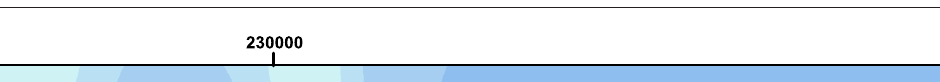
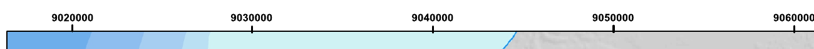
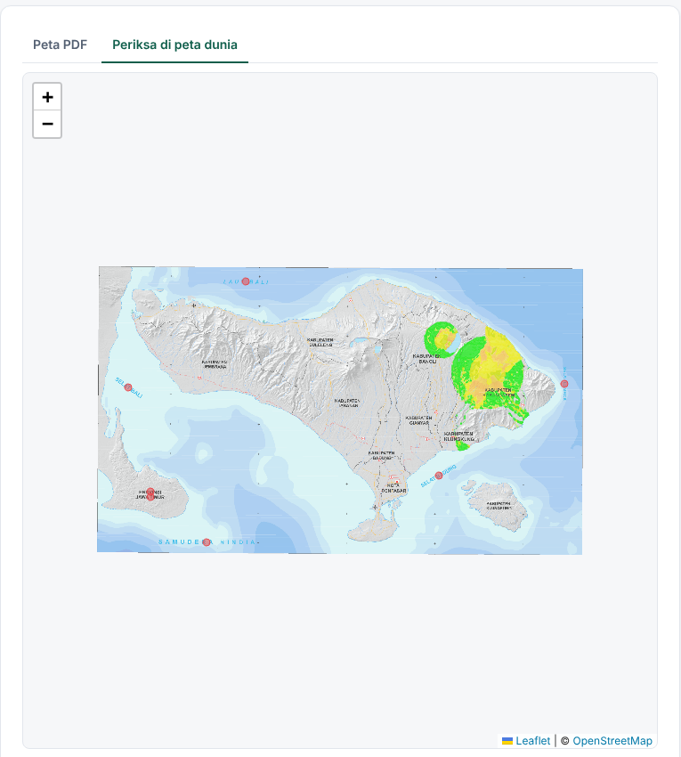
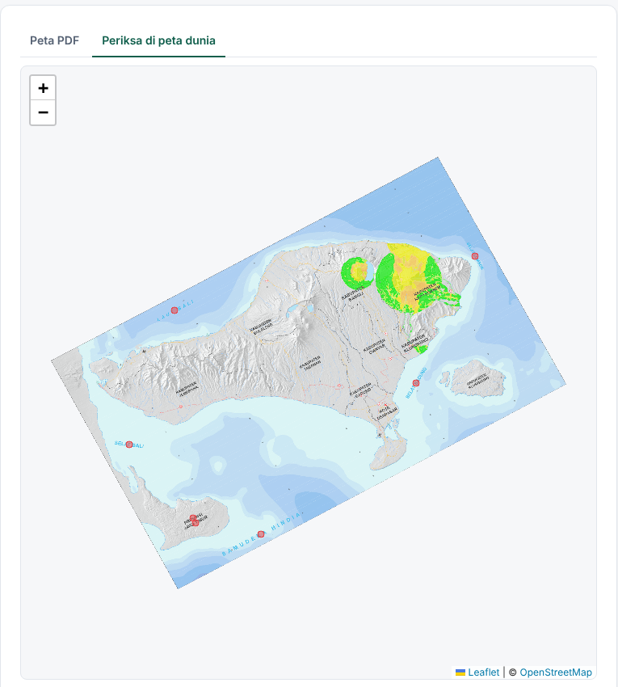
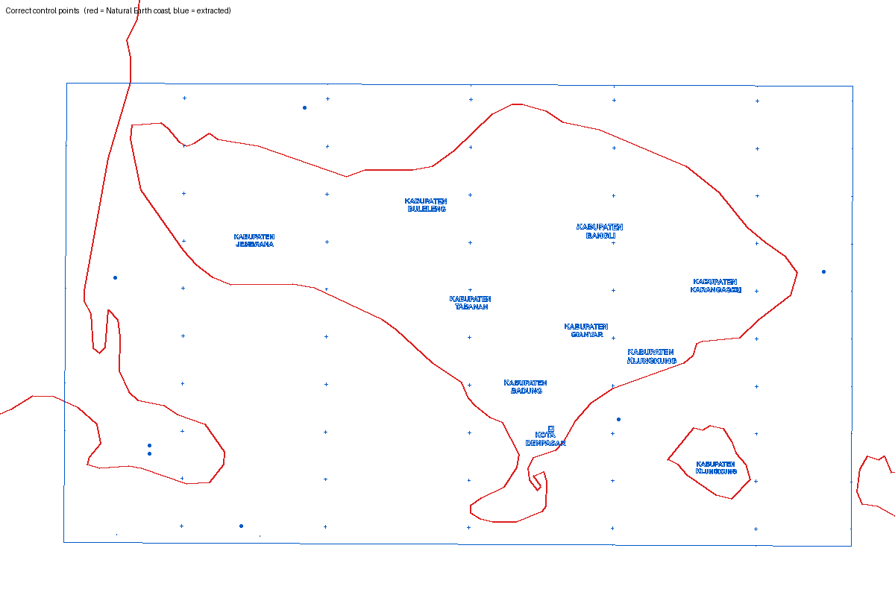
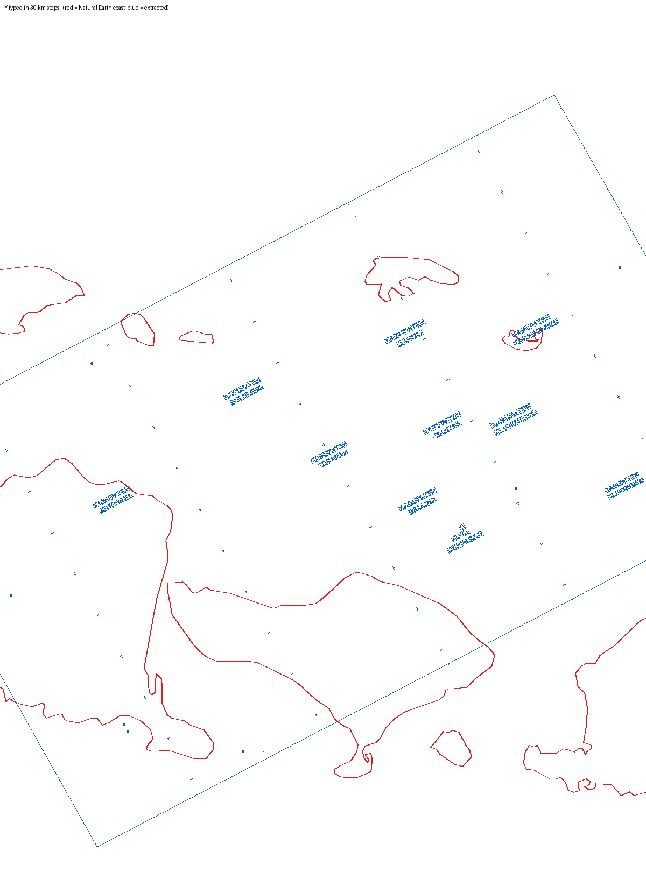
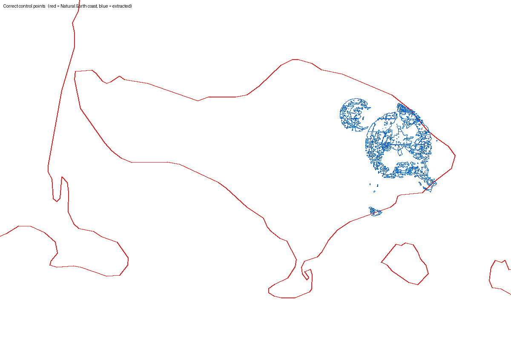
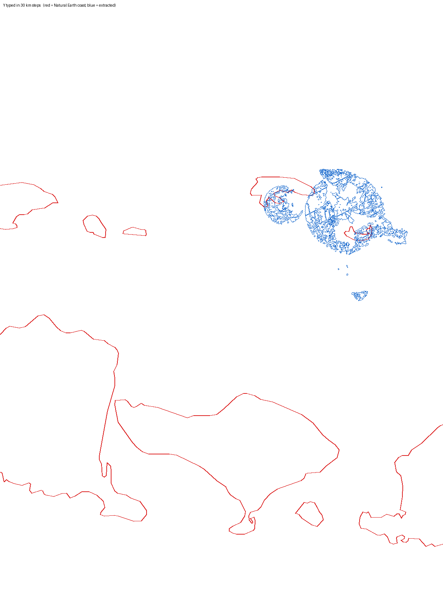

# Inspection: BNPB volcano risk map of Bali (PDF → GeoJSON)

**Map:** *11. Peta Risiko Letusan Gunungapi Provinsi Bali* (BNPB, Dec 2022), A1, 1 : 200 000, made in CorelDRAW 2018.
**Symptom:** the PDF extractor (`ekstrak-pdf.html`) produced a GeoJSON, but on a web map the geometry did not sit in the right place, as if the coordinate system were wrong.

The PDF is not stored here (GeoSAI does not keep visitors' PDFs). Pass its path to the scripts below.

## Summary

The extractor's maths is correct for this map. With the right control points, every output lands where it should: the frame on Bali, the kabupaten labels in their kabupaten, and the risk zones on Agung and Batur (RMSE 1.7 m over all 50 grid crosses). The wrong-looking result is what this map produces when **one typed coordinate does not match its cross**. The most likely cause is the map's grid, which is easy to misread:

| | Easting (X) | Northing (Y) |
|---|---|---|
| Grid labels on the frame | 230000 · 260000 · 290000 · 320000 · 350000 | 9020000 · 9030000 · … · 9110000 |
| Interval | **30 000 m** | **10 000 m** |
| Spacing on paper | 416.25 pt (146.8 mm) | 138.79 pt (49.0 mm) |

The note in the legend says *"UTM : Zona 50 S Interval Antar Grid 30.000 Meter"*, but that is true only for X. Going up one row of crosses adds 10 000 m, not 30 000 m. The paper scale is the same both ways (72.1 m per pt, so 1 : 204 000); only the grid interval differs.




## First principles

1. A PDF stores the map in page units (points). A map printed in one projection (here UTM 50 S, EPSG:32750) is linked to those page units by an **affine transform**: page (px, py) → UTM (X, Y). The extractor fits it from control points, then converts UTM to WGS 84 longitude/latitude for GeoJSON (RFC 7946). That conversion is correct (`pdfgeo.js` → `projector`).
2. For a north-up map with a square grid of metres, the transform is **a scale and a shift, with no rotation**: one point on paper is the same distance on the ground in X and in Y.
3. With **two** points the extractor fits a similarity (scale + rotation + shift). If one coordinate is wrong, the X and Y scales disagree, and a similarity can only absorb that by **rotating and rescaling** the whole map. The result is a tilted, stretched, shifted map. It still has the right shape, so it looks like a "coordinate system" problem.
4. *Lengkapi dari grid* (complete from grid) then rounds each cross to the nearest multiple of a guessed interval. A wrong first fit gives a wrong guess (20 000 m instead of 10 000 m), so the wrong fit is reinforced, not corrected.

## What the extractor sees in this PDF

From `node diagnose.mjs <pdf>`:

```
vector paths 1000 · in frame 348
pictures 108 · in frame 102 · dpi 200
frame (pt) [ 58.2, 297.2, 2342.6, 1638.4 ]          ← correct map frame
coordinate system from the notes { epsg: 32750 }    ← correct (UTM 50 S)
grid crosses 50 · spacing (pt) { x: 416.25, y: 138.79 }   ← 5 columns × 10 rows
```

* **The whole map body is one flattened 200-dpi picture**: 102 strips of 6348 × 37 px covering the frame. The picture holds the hillshade, sea, coastline, rivers, roads, boundaries and the risk zones. The only vectors inside the frame are the grid crosses, symbols and labels (drawn as letter outlines). The *Garis & poligon vektor* step therefore cannot give coastlines or zones from this file. The risk zones can only come from **Warna legenda → poligon** (colour classes).
* Grid labels are letter outlines, not text, so they cannot be read automatically. They have to be typed.

## Reproduction: right vs. wrong control points

Two crosses: bottom-left (230000, 9020000) and top-right (350000, 9110000).

| Scenario | 2-point fit | Grid guess | Crosses added | RMSE | Map frame (lon, lat) |
|---|---|---|---|---|---|
| **Right**: Y = 9110000 | 72.1 m/pt, rotation 0.0° | 10 000 m | 48 | **1.7 m** | 114.32 E, 8.89 S → 115.82 E, 8.02 S |
| **Wrong**: Y = 9290000 (9 rows × 30 km) | 142.0 m/pt, rotation **29.2°** | 20 000 m | 10 | **2.7 km** | tilted 29°; NE corner at 6.21 S, 1.8° too far north |

The same results come out of the real page in headless Chromium (`e2e.cjs`). The page shows the large error as a warning: *"Galatnya besar: periksa titik grid otomatis…"*. That warning is the signal to recheck the typed values.

| Right | Wrong (Y in 30 km steps) |
|---|---|
|  |  |
|  |  |
|  |  |

Red: Natural Earth coastline (`public/data/basemap.json`). Blue: extracted features.

Other typing errors that give the same kind of distortion are swapping X and Y in one point, or a dropped or extra zero. All of these break rule 2: the X and Y scales stop agreeing.

## How to extract this map correctly

1. Coordinate system: keep **UTM zona 50 S** (detected). Enter coordinates as **X/Y peta (meter)**.
2. Click two crosses far apart and type the labels on **their own row and column**. For example:
   * bottom-left cross → `230000`, `9020000`
   * top-right cross → `350000`, `9110000`
3. Check the fit line. *Skala peta ±1 : 204.300* is right; about 1 : 400 000, or any rotation, means a typo.
4. *Jarak grid* should show **10000**. Press *Lengkapi dari grid*: 48 crosses are added, RMSE about 2 m.
5. For the risk zones, use **Warna legenda → poligon**. Use one class per legend colour, or *Ambil gradasi* on the 0–1 *Indeks Risiko* bar. The vector layers only hold labels and symbols.

`hasil/kelas_risiko_benar.geojson` is a quick 3-class run of these steps. It has one picked colour per class, so it is not a complete classification. Its zones sit on Gunung Agung and the Batur caldera.

## Files

| File | What |
|---|---|
| `diagnose.mjs` | Runs `pdfgeo.js` + vendored pdf.js on the PDF in Node. Prints the grid, frame and CRS, fits both scenarios, and writes `hasil/vektor_*.geojson`. |
| `e2e.cjs` | Drives `ekstrak-pdf.html` in headless Chromium (Playwright) with the same steps, then saves the downloads and the check-tab screenshot. |
| `plot.py` | Draws GeoJSON over the Natural Earth coastline (Pillow). |
| `hasil/` | Outputs of the runs above. |
| `img/` | Figures in this report. |

```sh
node inspeksi/peta-risiko-letusan-bali/diagnose.mjs path/to/peta.pdf
npm start &   # serves public/ on :8000
NODE_PATH=$(npm root -g) node inspeksi/peta-risiko-letusan-bali/e2e.cjs path/to/peta.pdf out benar
python3 inspeksi/peta-risiko-letusan-bali/plot.py public/data/basemap.json a.geojson a.png b.geojson b.png
```

## Possible improvements to the extractor (not made here)

* **Warn about rotation and scale mismatch from the first two points.** Before fitting, compare |ΔX|/|Δpx| with |ΔY|/|Δpy|. Here that is 72 against 216 m/pt, a 3× mismatch. Also warn when a projected-CRS fit rotates more than about 2°. Either check catches every typo above as soon as the second point is typed, before *Lengkapi dari grid* builds on it.
* **Guess the grid interval per axis** (30 000 m × 10 000 m here) and show both. Today one interval comes from the smaller spacing. That still works here, because 30 000 is a multiple of 10 000, but it hides the unusual grid from the user.
* **Say when the map body is a single picture.** For example: "Isi peta berupa gambar: gunakan Warna legenda → poligon". Then nobody expects coastlines from the vector step.
